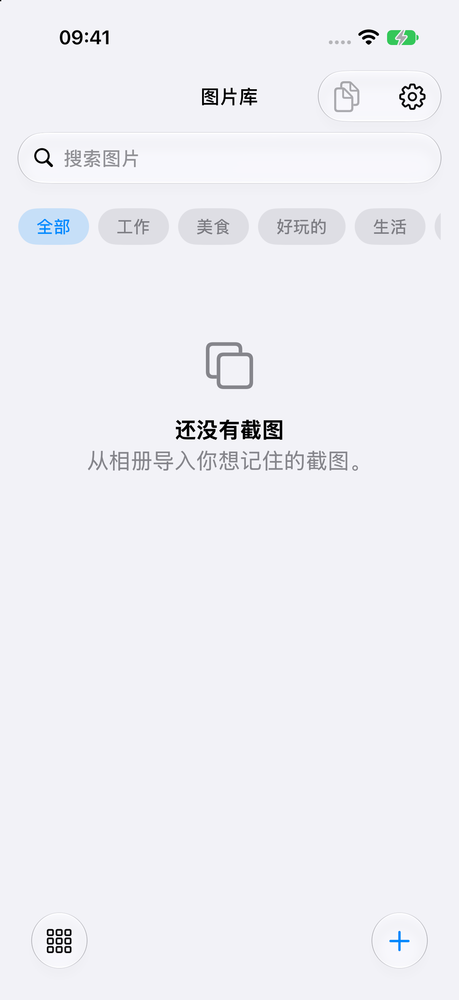
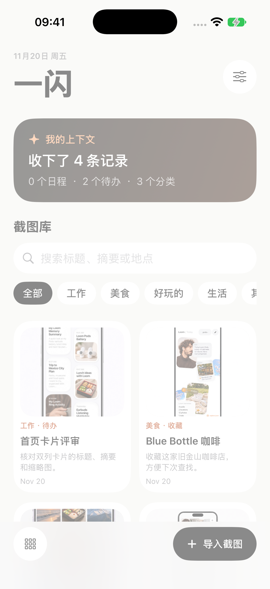

# Yishan 一闪

Yishan is a SwiftUI app that turns iPhone screenshots into searchable records. Save a café to revisit, recover a task from a conversation, or turn a screenshot with a date and time into a Calendar event.

[Project website](https://jakeyyyy.github.io/yishan/) · [Watch the demo](https://jakeyyyy.github.io/yishan/#demo) · [Download the complete Xcode project](https://jakeyyyy.github.io/yishan/Yishan-source.zip)

## Screenshots

| Import from Photos | Browse saved records |
| --- | --- |
|  |  |
| Tap **+** to pick screenshots. | An earlier build showing sample records. |

The app interface is in Chinese. The 15-second walkthrough uses app screenshots and English captions. [Watch on GitHub Pages](https://jakeyyyy.github.io/yishan/#demo) · [Open the MP4](https://jakeyyyy.github.io/yishan/walkthrough.mp4)

## How to use Yishan

1. **Import screenshots.** Tap **+** in the library, select up to 12 images from Photos, review the selection, and start recognition.
2. **Choose a recognition mode.** Yishan uses Apple Vision to read text on the device. To generate richer summaries and structured records, select TeamoRouter or Alibaba Cloud Bailian in Settings and enter your own API key. If a key is missing or a cloud request fails, Yishan falls back to on-device OCR when it can read text.
3. **Find and edit records.** Search by title, summary, or place, or browse by category. Open a record to review and edit the extracted details.
4. **Use the result.** Save a dated event to Calendar or a task to Reminders. You can also copy your library as plain text for use in another app.

## Optional screenshot automation

1. Enable automatic screenshot collection in Yishan Settings and grant Photos access. Allow notifications if you want progress and result alerts.
2. In Apple Shortcuts, create a personal automation using the **Screenshot** trigger.
3. Choose **Photos** as the save location and select **Run Immediately**.
4. Add Yishan’s **Summarize New Screenshot** action (摘要新截图), then save the automation.

Background execution depends on the iOS version and the permissions granted. Manual import also works as a standalone workflow.

## Data and permissions

- Yishan stores records and image previews on the device. Provider API keys are kept in the iOS Keychain.
- When cloud recognition runs, the selected provider receives a processed screenshot, readable embedded image metadata, and OCR text when available.
- Photos access supports screenshot import and automatic collection. Calendar and Reminders request access when used. Notifications require their own permission.

## Build from source

The project targets iOS 17 or later. Use Xcode with an SDK that includes the iOS 26 App Intents APIs.

1. Download and extract the [source archive](https://jakeyyyy.github.io/yishan/Yishan-source.zip).
2. Open `Flash.xcodeproj`, select the **Flash** scheme, and run it on an iPhone simulator.
3. For a physical iPhone, select your development team and configure a bundle identifier available to that team.

The archive contains `App/` (SwiftUI app and system integrations), `Tests/` (standalone Swift checks), `Preview/` (development screenshots), and `docs/` (the project site and its media).

Run the standalone checks from the extracted project directory:

```sh
swiftc App/Extraction.swift App/VisionRoute.swift Tests/main.swift -o /tmp/yishan-checks
/tmp/yishan-checks
```
